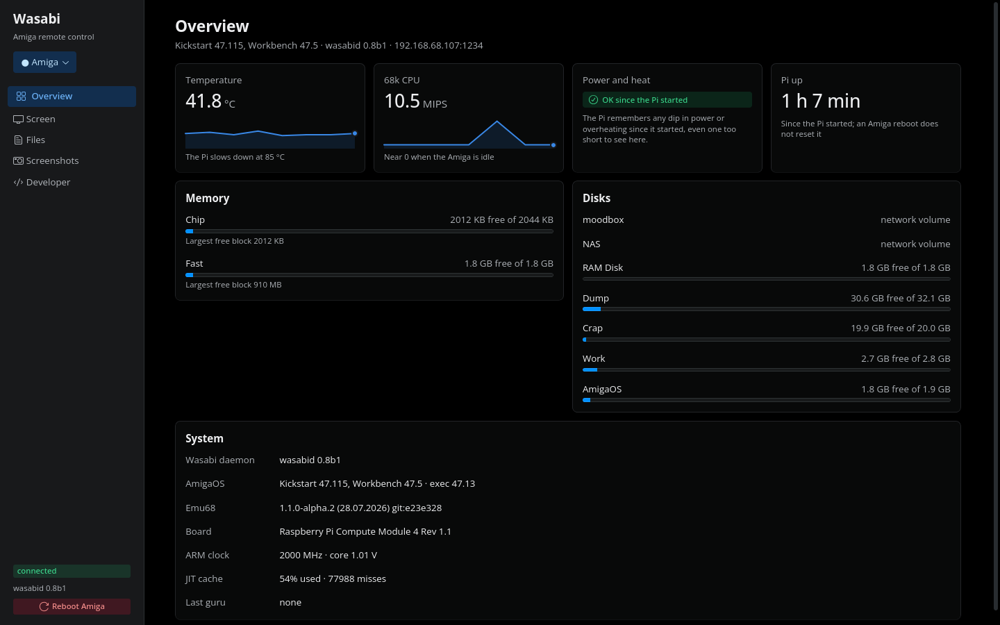
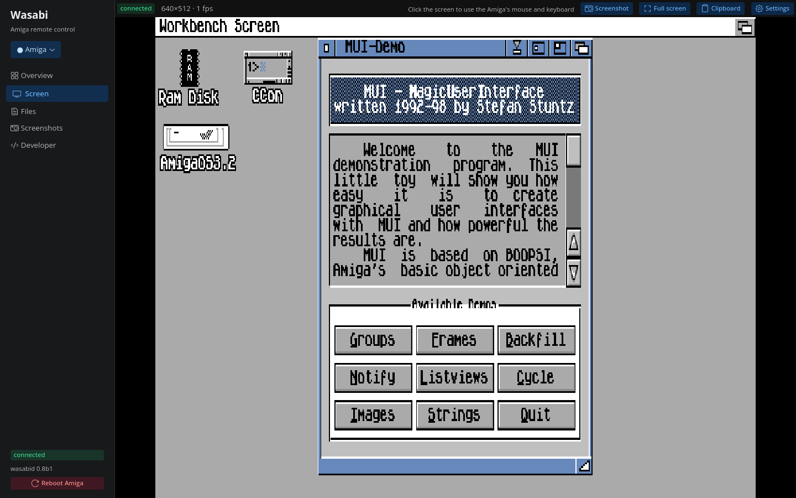
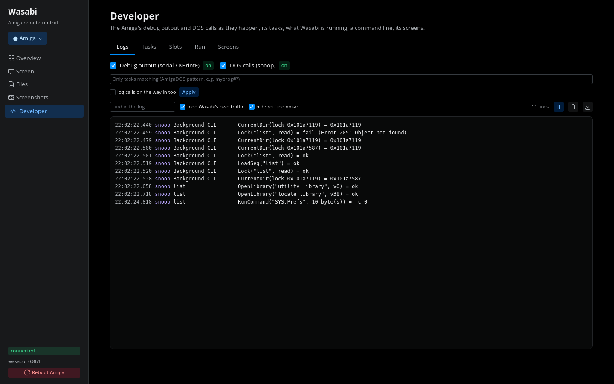

# Wasabi

[](https://github.com/creep-ltx/wasabi/actions/workflows/test.yml)

Drive a real Amiga from a PC, a phone, an Amiga script or an AI
assistant. A small daemon on the Amiga (`wasabid`) and a client on Linux
or macOS (`wasabi`, one Python file, standard library only).



## What it does

- **Develop on real hardware** - upload, run with live output and real
  exit codes, four commands at once; the Amiga's debug output and a
  SnoopDOS-style call trace live on the PC; crash reports that survive
  a reboot; the daemon updates itself and checks the new one first.
  [Debugging](docs/debugging.md)
- **See and drive the machine** - screenshots (whole screen, a window
  or a region), the live screen in a window with your mouse and
  keyboard, typing through the Amiga's own keymap, any key by name or
  code. [Screen and GUI](docs/screen-and-gui.md)
- **Buttons, menus and lists by name** - click "Save", fill in a text
  field, pick "Project/Quit", click an address-book entry - in
  Intuition, GadTools, ReAction and MUI windows.
  [Screen and GUI](docs/screen-and-gui.md#gadgets-and-menus-by-name-and-arexx)
- **Apps** - a desktop app (overview, screen, files, screenshots,
  developer tools) and the same app on a phone from a NAS, with history,
  alerts and nightly backups. [Apps](docs/apps.md)
- **ARexx both ways** - command any program's ARexx port; Amiga scripts
  drive the machine through Wasabi's own `WASABI` port.
- **AI assistants** - an MCP server for Claude Code, Claude Desktop,
  Codex, Gemini CLI, Cursor and others; JSON output and exit codes for
  scripts. [Scripts and AI](docs/scripting-and-ai.md)
- **PiStorm health** - Pi temperature, power dips, the 68k CPU load,
  memory. [Health](docs/apps.md#health)
- **Safe by design** - answers only the local network, needs a key, and
  encrypts with your own certificates when the Amiga has AmiSSL.
  [Security](docs/security.md)

<p>


</p>

## Quick start

1. **On the Amiga** - copy `wasabid` (any 68k) or `wasabid.020` (68020
   or better) from the [release](https://github.com/creep-ltx/wasabi/releases)
   to `C:` as `wasabid`, choose a key, start it. Put the last two lines
   in `S:User-Startup` to have it at every boot.
   ```
   SetEnv SAVE wasabi.key choose-a-key
   Run >NIL: C:wasabid
   ```
2. **On the PC** - put `wasabi` on your path and give it the key.
   ```
   ln -s $PWD/wasabi ~/.local/bin/wasabi
   mkdir -p ~/.config/wasabi && echo 'key = choose-a-key' > ~/.config/wasabi/config
   wasabi ping                      # finds the Amiga by itself
   wasabi desktop                   # the app in a window
   ```
3. **Encryption** (optional, needs AmiSSL 5 on the Amiga): `wasabi keys
   init`, `wasabi keys amiga NAME`, `wasabi restart`.
   [Security](docs/security.md)

More: [installing and updating](docs/install.md).

## Everyday commands

```
wasabi info / health                 what runs there; the Pi's vital signs
wasabi put LOCAL REMOTE / get        files both ways
wasabi run --max-time 30 "CMD"       run, stream its output, its exit code
wasabi grab [--window T|--region X,Y,W,H]   a screenshot (PNG)
wasabi view / desktop                the live screen / the whole app
wasabi ui list | click NAME | menu PATH | set NAME TEXT
                                     buttons, menus, fields, list rows
wasabi mouse click X Y / where       the pointer
wasabi key type TEXT / press KEYS    the keyboard (return, f12, ramiga+q, 0x45)
wasabi arexx PORT COMMAND            ARexx
wasabi debug / snoop                 the debug output / the call trace
wasabi update wasabid                replace the daemon, checked first
```

Every command and option: [Commands](docs/commands.md).

## Requirements

- **Amiga:** AmigaOS 3.x and a TCP/IP stack with `bsdsocket.library`
  (tested with rondoval's lwIP stack on Emu68 and FS-UAE's). AmiSSL 5
  only for encryption; MUI only to read MUI windows.
- **PC:** Linux or macOS with Python 3; OpenSSL 3 to make keys. The
  phone app runs anywhere Docker does
  ([`tools/docker-compose.yml`](tools/docker-compose.yml)).
- **Tested on:** an A1200 with PiStorm32-lite/CM4 on Emu68 (OS 3.2.3),
  and FS-UAE as an A1200 with a 68030 and as a stock 68020.

## Documentation

| | |
|---|---|
| [Installing and updating](docs/install.md) | the daemon, the client, self-update, building |
| [Commands](docs/commands.md) | every command and option |
| [The screen and the GUI](docs/screen-and-gui.md) | screenshots, the live view, mouse and keys, coordinates, gadgets, menus and lists by name, ARexx |
| [Apps](docs/apps.md) | the desktop app, Wasabi phone, health, the clipboard |
| [Debugging](docs/debugging.md) | debug output, the call trace, crash reports, stack headroom |
| [Scripts and AI](docs/scripting-and-ai.md) | JSON, exit codes, waiting, the MCP server |
| [Security](docs/security.md) | who may connect, encryption |
| [Design and status](docs/design.md) | what works where, measurements, why it is built this way, plans |
| [PROTOCOL.md](PROTOCOL.md) | the wire format |

## License

MIT - see [LICENSE](LICENSE).
