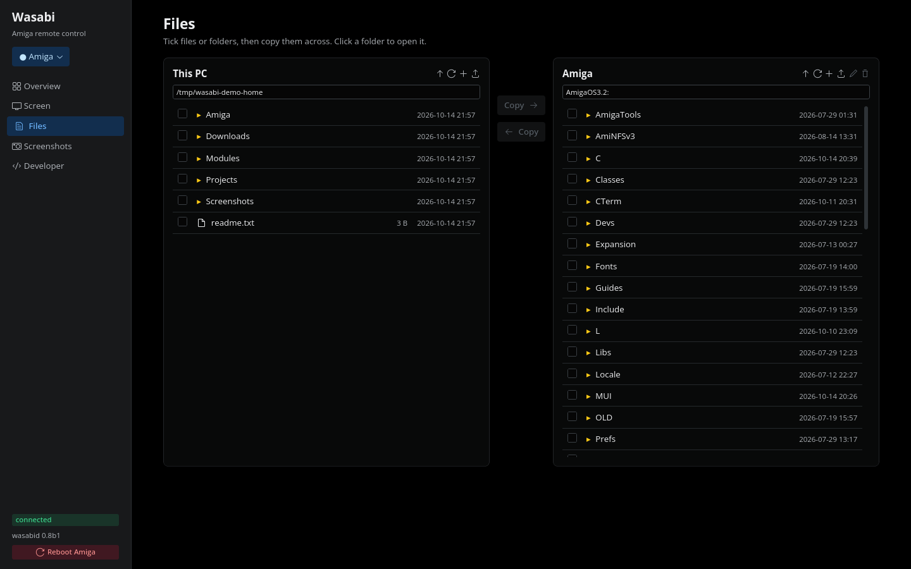

# Wasabi

[](https://github.com/creep-ltx/wasabi/actions/workflows/test.yml)
[](https://github.com/creep-ltx/wasabi/releases)
[](LICENSE)

**Remote control for a real Amiga** - from a Linux or macOS PC, a phone,
an Amiga script, or an AI assistant.

Wasabi is two programs: **`wasabid`**, a small daemon on the Amiga, and
**`wasabi`**, a client on the PC (one Python file, standard library
only). Together they copy files, run programs, show and drive the
Amiga's screen, and let you watch the machine think - its debug output
and its DOS calls, live, while your code runs on real hardware.


## Features

### Develop on real hardware

| | |
|---|---|
| **Files** | upload and download anywhere, any size (4 GB tested); an upload never leaves half a file in place |
| **Run** | run a command with its output streaming back and its real exit code; four at once; a time limit; start in the background |
| **Deploy** | upload and run, or upload and reboot, in one step |
| **Debug output** | every `KPrintF()` the Amiga prints, live on the PC - no serial cable |
| **DOS call trace** | SnoopDOS-style: 30 dos, exec, icon and diskfont calls with caller and result, filtered by task |
| **Crash reports** | the guru code and the dying task, kept across a reboot |
| **Tasks** | every task with its stack headroom; stop one by name |
| **Self-update** | `wasabi update` checks a new daemon four ways before it replaces the running one |

[More: Debugging](docs/debugging.md)

### See and drive the screen

| | |
|---|---|
| **Screenshots** | the front screen, one window or a region, RTG and native, as PNG; compare with an earlier one |
| **Live view** | the Amiga's screen in a window, driven with your mouse and keyboard; only changes are sent |
| **Mouse** | click, double-click, drag, drive menus, the wheel; ask where the pointer is |
| **Keyboard** | type text through the Amiga's own keymap (å, ä, ö, @ come out right); any key by name - F1-F12, Home, End, Page Up/Down, the keypad - or by raw code |
| **Windows and screens** | every screen and window as text: title, place, size, owner; bring one to the front |
| **Wait** | for a window, a task or a file to appear or go, or for the screen to change or settle |
| **Coordinates** | the picture's pixels, or with `--native` the screen's own |

[More: The screen and the GUI](docs/screen-and-gui.md)

### Buttons, menus and lists by name

```
$ wasabi ui list --window "Address Book"      # DCTelnet 1.10
      row 0    "Retro32 BBS"            at 122,146 397x16  [selected]
      row 1    "TeleHack simulation"    at 122,162 397x16
  button   "Connect"                at 129,300 93x26
$ wasabi ui click telehack --double
$ wasabi ui menu "Project/Quit"
```

- **Gadgets** - buttons, text fields, checkboxes, choosers, sliders, by
  their label; fill a text field in one step.
- **Menus** - pick an item by its path or name, without the mouse.
- **List rows** - the entries of a list, clickable by their text.
- **Where it works** - Intuition, GadTools, ReAction, MUI 4 and 5, and
  system requesters.

[More: Gadgets and menus by name](docs/screen-and-gui.md#gadgets-and-menus-by-name-and-arexx)

### The desktop app and Wasabi phone

<p>


</p>

- **`wasabi desktop`** - Overview (temperature, CPU, memory, disks),
  the live Screen, a two-pane file manager, Screenshots, and Developer
  tools (debug output, DOS calls, tasks, run slots, a command line).
  Several Amigas in one picker.
- **`wasabi serve`** - the same app on a phone, from a NAS or any Docker
  host: a login, history of the last day, alerts to your phone (heat,
  power dips, the Amiga going quiet, a guru), and a nightly backup of
  the Amiga's boot volume.

[More: Apps](docs/apps.md)

### ARexx both ways

- **`wasabi arexx PORT COMMAND`** - send to any program's ARexx port and
  get its RESULT; list the ports.
- **The `WASABI` ARexx port** - Amiga scripts and programs can type,
  press keys, click, click gadgets by name and pick menus, with no PC
  involved.

### Scripts and AI assistants

- **For scripts** - `--json` on everything that lists, clear exit codes,
  time limits, `wait` instead of sleeping.
- **MCP server** - 23 tools for Claude Code, Claude Desktop, Codex,
  Gemini CLI, Cursor and other MCP clients: run, files, screenshots,
  mouse, keyboard, gadgets and menus by name, ARexx, waiting.

[More: Scripts and AI](docs/scripting-and-ai.md)

### PiStorm health

The Pi's temperature, voltage and clocks, every power dip or overheat
since it started, Emu68's live 68k CPU meter and JIT cache, free memory,
the last guru. [More: Health](docs/apps.md#health)

### Security

- Answers only the local network (and VPN ranges you allow).
- A key, checked on every connection.
- **Optional encryption** - TLS 1.3 with your own certificates when the
  Amiga has AmiSSL; once an Amiga has been reached encrypted, the PC
  never quietly drops to plain with it.

[More: Security](docs/security.md)

## Quick start

1. **On the Amiga** - copy `wasabid` (any 68k) or `wasabid.020` (68020
   or better) from the [releases](https://github.com/creep-ltx/wasabi/releases)
   to `C:wasabid`, choose a key, start it. Add the last two lines to
   `S:User-Startup` to have it at every boot.
   ```
   SetEnv SAVE wasabi.key choose-a-key
   Run >NIL: C:wasabid
   ```
2. **On the PC** - put `wasabi` on your path and give it the key.
   ```
   ln -s $PWD/wasabi ~/.local/bin/wasabi
   mkdir -p ~/.config/wasabi && echo 'key = choose-a-key' > ~/.config/wasabi/config
   wasabi ping                      # finds the Amiga by itself
   wasabi desktop                   # the app in a window
   ```
3. **Encryption** (optional, needs AmiSSL 5 on the Amiga): `wasabi keys
   init`, `wasabi keys amiga NAME`, `wasabi restart`.

More: [Installing and updating](docs/install.md) - [every command](docs/commands.md).

## Everyday commands

```
wasabi info / health                 what runs there; the Pi's vital signs
wasabi put LOCAL REMOTE / get        files both ways
wasabi run --max-time 30 "CMD"       run, stream its output, its exit code
wasabi grab [--window T|--region X,Y,W,H]   a screenshot (PNG)
wasabi view / desktop                the live screen / the whole app
wasabi ui list | click NAME | menu PATH | set NAME TEXT
                                     buttons, menus, fields, list rows
wasabi mouse click X Y / where       the pointer
wasabi key type TEXT / press KEYS    the keyboard (return, f12, ramiga+q, 0x45)
wasabi arexx PORT COMMAND            ARexx
wasabi debug / snoop                 debug output / the DOS call trace
wasabi update wasabid                replace the daemon, checked first
```

## Requirements

| | |
|---|---|
| **Amiga** | AmigaOS 3.x and a TCP/IP stack with `bsdsocket.library`. AmiSSL 5 only for encryption; MUI only to read MUI windows. |
| **PC** | Linux or macOS with Python 3; OpenSSL 3 to make keys. |
| **Phone app** | any Docker host on the Amiga's network ([`tools/docker-compose.yml`](tools/docker-compose.yml)). |
| **Tested on** | an A1200 with PiStorm32-lite/CM4 on Emu68 (OS 3.2.3, rondoval's lwIP stack); FS-UAE as an A1200 with a 68030 and as a stock 68020. 261 client tests on Linux and macOS for every change. |

## Documentation

| | |
|---|---|
| [Installing and updating](docs/install.md) | the daemon, the client, self-update, building |
| [Commands](docs/commands.md) | every command and option |
| [The screen and the GUI](docs/screen-and-gui.md) | screenshots, the live view, mouse and keys, coordinates, gadgets, menus and lists by name, ARexx |
| [Apps](docs/apps.md) | the desktop app, Wasabi phone, health, the clipboard |
| [Debugging](docs/debugging.md) | debug output, the DOS call trace, crash reports, stack headroom |
| [Scripts and AI](docs/scripting-and-ai.md) | JSON, exit codes, waiting, the MCP server |
| [Security](docs/security.md) | who may connect, encryption |
| [Design and status](docs/design.md) | what works where, measurements, why it is built this way, plans |
| [PROTOCOL.md](PROTOCOL.md) | the wire format |

## License

MIT - see [LICENSE](LICENSE).
